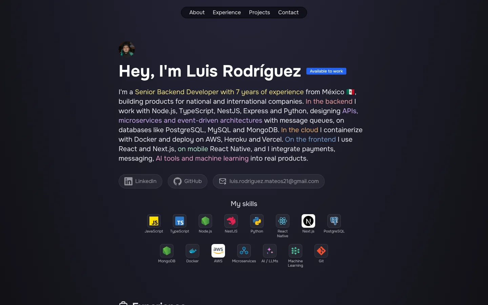

# Luis Rodríguez · Portfolio

Personal portfolio of **Luis Rodríguez**, Senior Backend Developer from México 🇲🇽 with 7 years of experience building products for national and international companies.

**Live site:** [luis-rodriguez-portfolio.vercel.app](https://luis-rodriguez-portfolio.vercel.app/)



## What's inside

- **About:** short introduction, contact links and skills.
- **Experience:** timeline of roles, from TROBBU (Senior Backend Developer) to my first web projects.
- **Projects:** selected work with screenshots and tech stack:
  - TROBBU: fractional ownership platform and mobile app
  - BdocOne: medical appointments platform (freelance)
  - Áurea: CRM for a jewelry business
  - HoyFit: fitness and nutrition app (in progress)
  - English Coach: AI-assisted English practice
  - Workplace survey platform for Great Place to Work®

## Tech stack

- [Astro 5](https://astro.build): static site, zero JavaScript by default
- [Tailwind CSS 3](https://tailwindcss.com) for styling
- TypeScript
- [Onest](https://fontsource.org/fonts/onest) variable font via Fontsource
- Deployed on [Vercel](https://vercel.com) (Node.js 24)

## Project structure

```text
/
├── docs/
│   └── preview.webp           # Screenshot used in this README
├── public/
│   ├── favicon.svg
│   └── images/
│       ├── foto.webp          # Profile photo
│       ├── projects/          # Project covers (16:9, .webp)
│       └── skills/            # Skill icons (.svg)
├── src/
│   ├── components/
│   │   ├── Experience.astro   # Experience list (edit here)
│   │   ├── ExperienceItem.astro
│   │   ├── Projects.astro     # Projects and tech tags (edit here)
│   │   ├── Skills.astro       # Skills grid (edit here)
│   │   ├── Header.astro
│   │   ├── Footer.astro
│   │   └── icons/             # Inline SVG icons
│   ├── data/
│   │   └── data.json
│   ├── layouts/
│   │   └── Layout.astro
│   └── pages/
│       └── index.astro        # Hero text and page sections
└── package.json
```

## Updating content

| To change… | Edit |
| :--- | :--- |
| Hero text, title and meta description | `src/pages/index.astro` |
| Work experience | `EXPERIENCIE` array in `src/components/Experience.astro` |
| Projects | `PROJECTS` array in `src/components/Projects.astro` |
| Tech tags on projects | `TAGS` object in `src/components/Projects.astro` |
| Skills | `SKILLS` array in `src/components/Skills.astro` |

Project images go in `public/images/projects/` (1600×900 `.webp` works best) and skill icons in `public/images/skills/`.

## Running locally

Requires **Node.js 24** (see `engines` in `package.json`).

```sh
npm install
npm run dev
```

| Command | Action |
| :--- | :--- |
| `npm install` | Install dependencies |
| `npm run dev` | Start the dev server at `localhost:4321` |
| `npm run build` | Type-check with `astro check` and build to `./dist/` |
| `npm run preview` | Preview the production build locally |

## Deployment

Every push to `main` deploys automatically on Vercel. The Node.js version is pinned to 24.x through the `engines` field in `package.json`.

## Contact

- LinkedIn: [luis-rodriguez-mateos](https://www.linkedin.com/in/luis-rodriguez-mateos/)
- GitHub: [luisRodriguez21](https://github.com/luisRodriguez21)
- Email: luis.rodriguez.mateos21@gmail.com
